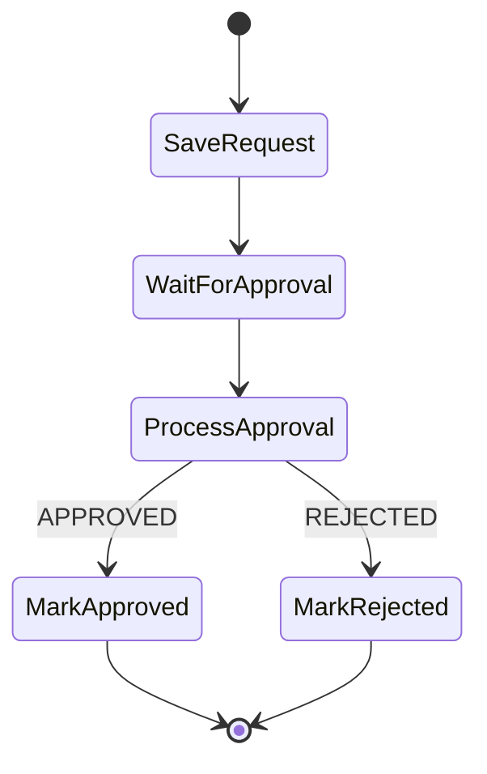

# Serverless Certification Approval System – Technical Deep Dive

## Project Overview

This document provides a detailed technical explanation of the Serverless Certification Approval System, including its architecture, AWS services, Lambda functions, Step Functions workflow, API Gateway configuration, and human-in-the-loop approval mechanism.

The solution demonstrates how to build an event-driven, serverless application that automates certification funding requests while allowing a manager to make the final approval decision.

---

## 1. System Architecture

### 1.1 Architecture Overview

The application allows users to submit certification funding requests through an HTTP API. Each submission starts an AWS Step Functions workflow, which records the request in DynamoDB and waits for a manager's decision.

The manager can approve or reject the request through a separate API endpoint. The decision is returned to Step Functions using the callback task-token mechanism, allowing the workflow to resume and update the request status.

### Architecture Diagram

```mermaid
flowchart TD
    Client[Client / PowerShell / cURL]

    APIGW[Amazon API Gateway<br/>HTTP API]

    Submit[SubmitRequestFunction]
    Approval[HandleApprovalFunction]
    Status[CheckStatusFunction]
    Notify[NotifyManagerFunction]

    SFN[AWS Step Functions<br/>ApprovalStateMachine]

    DDB[(Amazon DynamoDB<br/>CertificationRequests)]

    CW[Amazon CloudWatch Logs]

    Client -->|POST /request| APIGW
    Client -->|POST /approval| APIGW
    Client -->|GET /request/{requestId}| APIGW

    APIGW --> Submit
    APIGW --> Approval
    APIGW --> Status

    Submit -->|StartExecution| SFN

    SFN -->|PutItem: PENDING| DDB
    SFN -->|Invoke with Task Token| Notify

    Notify -.->|Log approval token for demo| CW

    Approval -->|SendTaskSuccess| SFN

    SFN -->|UpdateItem: Final Status| DDB

    Status -->|GetItem| DDB
```

### 1.2 Architecture Components

| AWS Service | Responsibility |
|---|---|
| Amazon API Gateway | Exposes HTTP endpoints for submitting requests, processing approvals, and checking request status. |
| AWS Lambda | Executes the application logic for request submission, manager notification, approval handling, and status retrieval. |
| AWS Step Functions | Orchestrates the approval workflow and manages the waiting period for human decisions. |
| Amazon DynamoDB | Stores certification request details and their approval statuses. |
| Amazon CloudWatch Logs | Stores Lambda execution logs, including the demonstration approval task token. |
| AWS IAM | Controls access between the AWS services using execution roles and permissions. |

### 1.3 Application Workflow

The application follows this sequence:

1. A user submits a certification request through `POST /request`.
2. API Gateway invokes `SubmitRequestFunction`.
3. The Lambda function starts the Step Functions state machine.
4. Step Functions saves the request in DynamoDB with the initial status `PENDING`.
5. Step Functions invokes `NotifyManagerFunction` using the callback task-token integration.
6. The notification Lambda logs the task token to CloudWatch Logs for demonstration purposes.
7. The workflow pauses while waiting for a manager's decision.
8. The manager submits an approval or rejection through `POST /approval`.
9. `HandleApprovalFunction` sends the decision to Step Functions using `SendTaskSuccess`.
10. Step Functions resumes execution and evaluates the decision.
11. The appropriate state updates DynamoDB to `APPROVED` or `REJECTED`.
12. Users can retrieve the latest request status through `GET /request/{requestId}`.

---

## 2. Lambda Functions – Technical Explanation

The application uses four Lambda functions, each responsible for a specific part of the workflow.

### 2.1 SubmitRequestFunction

**Source file:** `src/submit_request.py`

**Purpose:** Initiates a new certification approval workflow.

**Trigger:** `POST /request`

**Responsibilities:**

1. Receives the HTTP request from API Gateway.
2. Parses the incoming JSON payload containing:
   - `name`
   - `course`
   - `cost`
3. Uses the AWS SDK for Python (`boto3`) to connect to Step Functions.
4. Calls the `start_execution()` API operation.
5. Passes the certification request data to the state machine.
6. Returns the request identifier and execution information to the client.

**Key AWS Concept:**

The Lambda function does not directly write the initial request into DynamoDB. Instead, it delegates the workflow to Step Functions.

This approach centralizes the business process within the state machine, making the workflow easier to monitor, maintain, and extend.

### 2.2 NotifyManagerFunction

**Source file:** `src/notify_manager.py`

**Purpose:** Simulates notifying a manager that a certification request requires approval.

**Trigger:** Invoked by Step Functions through the callback integration.

**Input:**

The function receives the workflow input together with a special `taskToken` generated by Step Functions.

**Responsibilities:**

1. Receives the certification request details.
2. Extracts the callback task token.
3. Logs the task token to CloudWatch Logs.
4. Completes its Lambda execution.

**Key AWS Concept – Wait for Task Token:**

The function uses the Step Functions callback integration:

`arn:aws:states:::lambda:invoke.waitForTaskToken`

The `.waitForTaskToken` integration allows Step Functions to pause the workflow until an external process returns the task token through an appropriate callback API.

Although the Lambda function finishes executing, the Step Functions execution remains suspended in the waiting state.

In a production implementation, this function could send an approval notification through:

- Amazon Simple Email Service (SES)
- Amazon Simple Notification Service (SNS)
- Slack or Microsoft Teams integrations
- An internal approval portal

**Important Security Note:**

The task token is a sensitive callback credential. Logging it is acceptable only for a controlled demonstration. In production, it should be securely delivered and stored, and should not be exposed in general-purpose application logs.

### 2.3 HandleApprovalFunction

**Source file:** `src/handle_approval.py`

**Purpose:** Processes the manager's approval or rejection decision and resumes the paused workflow.

**Trigger:** `POST /approval`

**Expected Input:**

- `requestId`
- `decision`
- `taskToken`

**Responsibilities:**

1. Receives the manager's decision through API Gateway.
2. Extracts the request identifier, decision, and task token.
3. Validates that the decision is either `APPROVED` or `REJECTED`.
4. Uses the Step Functions `send_task_success()` API operation to return the decision to the waiting workflow.
5. Sends the decision as JSON output for the state machine to process.

**Key AWS Concept – SendTaskSuccess:**

The `SendTaskSuccess` operation provides a way for an external application to resume a paused Step Functions task.

The task token identifies the specific waiting task.

When the correct token and callback output are supplied, Step Functions resumes execution and continues to the next state.

For this project, the manager's decision is passed back to the state machine, which determines whether the request should be approved or rejected.

**Important:** The approval endpoint should be protected by authentication and authorization in a production environment. Merely supplying a valid task token should not be treated as a complete manager authorization mechanism.

### 2.4 CheckStatusFunction

**Source file:** `src/check_status.py`

**Purpose:** Retrieves the current status of a certification request.

**Trigger:** `GET /request/{requestId}`

**Responsibilities:**

1. Receives the request identifier from API Gateway path parameters.
2. Connects to DynamoDB using `boto3`.
3. Executes a `GetItem` operation against the `CertificationRequests` table.
4. Retrieves the corresponding request record.
5. Returns the stored request details and current approval status.

**Key AWS Concept:**

This function separates read operations from the approval workflow.

Instead of querying Step Functions execution history every time a user wants to check a request, the application reads the latest persisted status directly from DynamoDB.

This makes status retrieval simple and independent of whether the workflow is currently running, waiting, or completed.

---

## 3. AWS Step Functions – Workflow Orchestration

AWS Step Functions acts as the central orchestration service of the application.

It manages the sequence of operations, controls the approval process, handles the waiting period, and determines the final request status.

**State machine definition:** `step-functions-definition.json`

### 3.1 Workflow Diagram



### 3.2 Explanation of Each State

#### State 1: SaveRequest

**Type:** Task

**Integration:** DynamoDB `PutItem`

This state creates a new item in the `CertificationRequests` DynamoDB table.

It stores the request information and initializes the status as:

`PENDING`

The request is persisted before the approval notification is initiated, ensuring that the application has a record to reference while the workflow is waiting.

#### State 2: WaitForApproval

**Type:** Task

**Integration:** Lambda callback with task token

**Resource:**

`arn:aws:states:::lambda:invoke.waitForTaskToken`

This is the most important state in the project.

Unlike a normal Lambda invocation, the callback integration allows Step Functions to wait for an external response before continuing.

The process works as follows:

1. Step Functions generates a unique task token.
2. The token is included in the Lambda invocation payload.
3. `NotifyManagerFunction` receives and logs the token.
4. The Lambda invocation completes.
5. Step Functions remains in the waiting state.
6. The manager submits a decision through the approval API.
7. `HandleApprovalFunction` calls `SendTaskSuccess` using the task token.
8. Step Functions resumes execution.

**Why is this useful?**

Without the callback pattern, the application would need to continuously poll for approval or keep a process running while waiting for a human decision.

The callback pattern allows a Standard Workflow to wait for an external response without keeping a Lambda execution running during the waiting period.

Standard Workflows support long-running executions, with a maximum execution duration of up to one year.

#### State 3: ProcessApproval

**Type:** Choice

This state evaluates the decision returned through the callback.

It acts like an `if/else` statement in traditional programming.

The workflow evaluates the decision:

- If `decision == APPROVED`, proceed to `MarkApproved`.
- If `decision == REJECTED`, proceed to `MarkRejected`.

This keeps the decision-making logic within the state machine instead of hardcoding the workflow transitions inside a Lambda function.

#### State 4: MarkApproved

**Type:** Task

**Integration:** DynamoDB `UpdateItem`

When the decision is `APPROVED`, Step Functions updates the corresponding DynamoDB record.

The request status becomes:

`APPROVED`

The workflow then completes successfully.

#### State 5: MarkRejected

**Type:** Task

**Integration:** DynamoDB `UpdateItem`

When the decision is `REJECTED`, Step Functions updates the corresponding DynamoDB record.

The request status becomes:

`REJECTED`

The workflow then completes successfully.

### 3.3 Why Use AWS Step Functions?

Step Functions provides several benefits:

- **Workflow orchestration:** Coordinates multiple AWS services without requiring a single Lambda function to manage the entire process.
- **Visual monitoring:** Provides a graphical representation of workflow execution and individual state transitions.
- **Human approval integration:** Supports callback patterns for processes requiring external decisions.
- **Error handling:** Supports retry and catch mechanisms for handling failures.
- **Execution history:** Provides visibility into workflow execution, input, output, and state transitions.
- **Scalability:** Allows application workflows to operate without managing servers or long-running application processes.

---

## 4. API Gateway – HTTP API Configuration

Amazon API Gateway provides the HTTP interface between external clients and the Lambda functions.

This project uses an HTTP API rather than a REST API.

HTTP APIs provide a lightweight option for exposing Lambda-backed endpoints and generally have lower cost and simpler configuration for this type of application.

### 4.1 API Routes

| HTTP Method | Endpoint | Lambda Integration | Purpose |
|---|---|---|---|
| POST | `/request` | SubmitRequestFunction | Submit a new certification request. |
| POST | `/approval` | HandleApprovalFunction | Submit an approval or rejection decision. |
| GET | `/request/{requestId}` | CheckStatusFunction | Retrieve the current request status. |

### 4.2 Integration Configuration

Each API route is connected to its corresponding Lambda function.

For example:

`POST /request` → `SubmitRequestFunction`

When a client sends an HTTP POST request to this endpoint, API Gateway invokes the configured Lambda integration and passes the HTTP request information to the function.

### 4.3 Payload Format Version

This project uses API Gateway HTTP API payload format version `2.0`.

The payload format determines the structure of the event object passed to the Lambda function.

Common event properties include:

- `event['body']` – Contains the HTTP request body.
- `event['pathParameters']` – Contains URL path parameters.
- `event['requestContext']` – Contains request metadata.

For example, when a client accesses:

`GET /request/12345`

The Lambda function can retrieve the request identifier from the path parameters.

---

## 5. Cross-Origin Resource Sharing (CORS)

### 5.1 Why CORS Was Originally Considered

The original implementation considered building an HTML frontend that would allow users to submit certification requests through a browser.

For example:

- Frontend hosted on Amazon S3.
- Backend hosted on Amazon API Gateway.

Since these resources would have different origins, browser-based requests would require appropriate CORS configuration.

### 5.2 Why CORS Is Not Required for the Current Demonstration

The frontend was removed to simplify the project.

Requests are now submitted using command-line tools such as:

- PowerShell
- cURL

Command-line HTTP clients do not enforce browser CORS restrictions.

Therefore, CORS configuration is unnecessary for the current command-line demonstration.

**Important:** If a browser-based frontend is introduced later, configure CORS on the HTTP API to allow the frontend's origin, methods, and required headers.

---

## 6. IAM – Security and Permissions

AWS IAM controls the permissions required for the different services to communicate.

The architecture involves two main categories of execution roles.

### 6.1 Lambda Execution Roles

Lambda functions require permissions to access the AWS services they interact with.

Examples include:

| Lambda Function | Required Permissions |
|---|---|
| SubmitRequestFunction | `states:StartExecution` |
| NotifyManagerFunction | CloudWatch Logs permissions |
| HandleApprovalFunction | `states:SendTaskSuccess` |
| CheckStatusFunction | `dynamodb:GetItem` |

### 6.2 Step Functions Execution Role

The Step Functions state machine requires its own IAM execution role.

This role should allow it to:

- Invoke `NotifyManagerFunction`.
- Insert records into DynamoDB.
- Update records in DynamoDB.

Use resource-specific permissions wherever possible instead of granting broad administrator or full-service access.

### 6.3 Security Recommendations

For a production implementation:

- Apply least-privilege IAM policies.
- Authenticate and authorize manager approval requests.
- Avoid exposing task tokens in CloudWatch Logs.
- Enable appropriate API authorization.
- Validate request data and approval decisions.
- Consider encryption and retention requirements for stored request information.
- Use CloudWatch monitoring and alarms for workflow failures.

---

## 7. Error Handling and Workflow Considerations

### 7.1 Standard vs Express Workflows

This project should use an AWS Step Functions **Standard Workflow**.

| Feature | Standard Workflow | Express Workflow |
|---|---|---|
| Maximum execution duration | Up to 1 year | Up to 5 minutes |
| Execution model | Durable execution | Short-duration execution |
| Callback task-token pattern | Supported | Not supported |
| Suitable for human approval | Yes | No |

The human approval process may take minutes, hours, or days. Therefore, Standard Workflows are appropriate.

### 7.2 Task Token Expiration

A callback task token is associated with a specific waiting task.

If the task times out or the workflow execution expires, the token can no longer be used to resume that task.

This can result in errors when submitting an approval decision.

For the demonstration, submit a new request and use its corresponding task token if the original execution has timed out.

### 7.3 Additional Production Improvements

The current project is a functional demonstration. A production-ready implementation could be extended with:

- Amazon SES notifications.
- Cognito or another identity provider for manager authentication.
- An approval dashboard.
- Retry and error-handling states.
- Approval deadlines and timeout handling.
- An audit trail of approval decisions.
- SNS notifications when requests are approved or rejected.

---

## 8. Conclusion

The Serverless Certification Approval System demonstrates how multiple AWS services can be integrated to build an automated approval workflow without managing servers.

The project combines:

- Amazon API Gateway for HTTP-based communication.
- AWS Lambda for serverless application logic.
- AWS Step Functions for workflow orchestration.
- The callback task-token pattern for human-in-the-loop approval.
- Amazon DynamoDB for persistent request tracking.
- AWS IAM for service permissions and access control.
- Amazon CloudWatch for operational logging.

The most important concept demonstrated by this project is the integration of human decision-making into an automated serverless workflow using AWS Step Functions and the callback task-token mechanism.

This architecture can be extended to support employee training approvals, expense claims, purchase requests, access provisioning, and other business approval processes.
